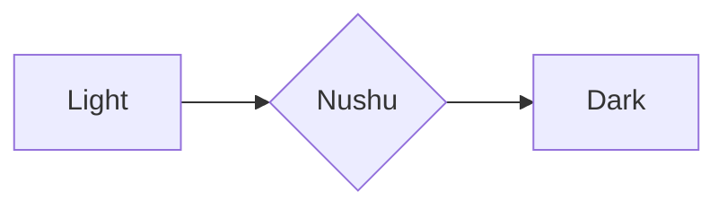

# Tables, HTML, and extras

| Left aligned | Centered | Right aligned |
| :----------- | :------: | ------------: |
| `code`       | **bold** |          1.00 |
| *italic*     | [link](https://example.com) | 22.50 |
| ~~struck~~   | \| pipe  |        333.00 |

Click to expand

Hidden content with **Markdown** inside HTML.

<kbd>Ctrl</kbd> + <kbd>Shift</kbd> + <kbd>P</kbd>

  

<!-- An HTML comment -->

Footnote reference[^1] and another[^note].

[^1]: The footnote text.
[^note]: A named footnote with `code`.

Inline math $E = mc^2$ and a block:

$$
\int_0^\infty e^{-x^2}\,dx = \frac{\sqrt{\pi}}{2}
$$

Emoji shortcodes :sparkles: :tea: and a mention @octocat, issue #42.
